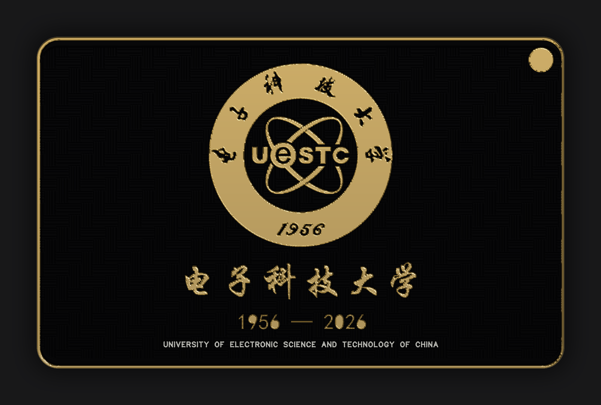
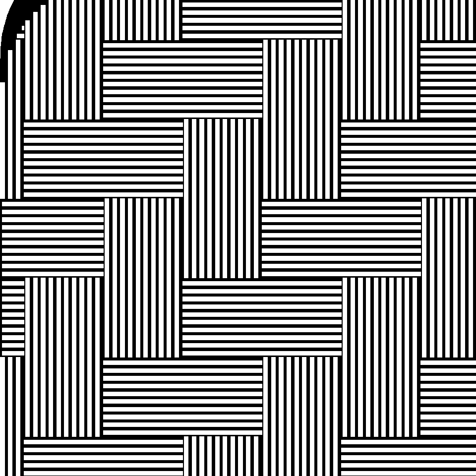

[](https://github.com/YHLLXY/pcb-art-skill/actions/workflows/ci.yml)
[](LICENSE)
[](https://www.python.org/)
[](tests)

# gift-pcb

**Design decorative PCBs — birthday cards, school emblems, keychains, badge boards — from a reference photo to a JLCPCB-ready Gerber package.**

一块只有美术、没有电路的 PCB：哑黑阻焊 + 沉金 + 白丝印。
从参考板/校徽照片出发，一路做到能下单的 Gerber 包。



<sub>上面的板子是 UESTC70 纪念板：86×54 mm，哑黑 + 沉金，2 mm 编织纹回放参考板纹路表，`13-check --weave` 全绿。</sub>

> 不是"PCB 画图工具"。它是一套**工艺规则 + 中文审美 + 实测数字**的工作流：
> 金色到底怎么算、扫描线要多少步距、背面为什么要镜像、3D 里怎么验收。

## 它解决什么

| 你遇到的情况 | 这个 skill 给的答案 |
|---|---|
| 参考板看着是金/黑/白，复刻出来不像 | 分层看：铜≠金，只有"铜+开窗"才发金（`01`） |
| 校徽描得不像 | 整枚描摹官方 1024 px 线条图，不拆开重构（`02`） |
| 金面积到底算多少 | 一个口径算到底：**并集 ÷ 板框**，参考板 22.00%（`02`「两套口径」） |
| 金色一多就被拒单 | 12–24% 是正常区间，配比表 + 从 Gerber 复算的公式（`02`/`06`） |
| 背面字是反的 | 三层（2/4/6）全部镜像生成；`mirror:true` 无效（`04` 第 88 条） |
| 背景编织纹怎么都不像 | 不调参数，**回放参考板的 2 mm 纹路表**（`15-weave.py`） |
| 写半天 EDA 脚本 | 直接写 `.epcb2` 文本，3 分钟落板（`03` 第八节） |
| 做完才发现方向不对 | 开工前 8 问 + 打包前 14 条 3D 验收（`06`） |
| 参考板上有现成的好东西，要不要抄 | `07` 十条抄清单，逐条量完、由用户定 |

## 八阶段

```
P0 立项 → P0.5 访谈 → P1 解码素材 → P2 版式 mock → P3 矢量/制造性
                                    → P4 落 EDA → P4.5 3D 验收 → P5 导出复核
```

两个最容易跳过、也最贵的闸门：**P0.5（问完再动手）** 和 **P4.5（用户说"可以了"才算完）**。

## 编织纹：抄表，不要调参



<sub>80 px/mm 单独看一块 12×12 mm——织纹在合成图里永远像"一片灰"，20 px/mm 看不出来。</sub>

参考板的织纹是以 **2 mm 为单元的 4×4 朝向表**（`VHHV/HHVV/HVVH/VVHH`）铺出来的，
不是"每 4 mm 一个方块"。所以正确做法是**把这 16 格的朝向当数据回放**：
`15-weave.py` 从参考板 Gerber 里提表，`13-check --weave` 逐格比对，
本项目实测 **100% 吻合**（早期靠猜参数、方块做 4 mm 高的版本只有 77.8%，肉眼一看就散）。

## 实测数据（不是经验值）

| 项 | 值 | 来源 |
|---|---|---|
| 扫描步距 | 0.06 mm（条带 0.075，重叠 0.015） | 100 px/mm 光栅化实测连续 |
| 扫描步距（徽记） | 0.0125 mm + 源图 3× 上采样 | 圆沿半径偏差 0.015 mm |
| 最小铜/丝印 | 0.13 / 0.15 mm | 生成后逐层量 p5 分位 |
| 沉金占比（本板） | UESTC70 v10 **22.46%**（正 18.42 / 背 11.73） | `13-check` 复算 |
| 沉金占比（参考板） | **22.00%**（正 19.04 / 背 9.37） | 同尺寸样板 Gerber，同口径 |
| 参考板三色配比 | 金 22.00% / 白 24.27% / 哑黑 60.26% | 同上（背面大幅书法，白才这么高） |
| 织纹吻合度 | 100%（8×8 单元全中） | `13-check --weave` |
| 落板速度 | 3.7 万图元 ≈ 3 分钟 | 直接写 `.epcb2` |

## 仓库结构

```
SKILL.md              八阶段、三条铁律、最贵的 13 条、自检闸门
references/
  01-参考板解码.md      逐层判断铜/金/丝印/孔（只讲怎么读层）
  02-制造性与矢量.md    线宽、扫描线、徽记两种原型、参考配比、金面积口径
  03-EDA落地.md         API 表、层号、.epcb2 格式、CIRCLE/ARC 路径
  04-踩坑清单.md        118 条，按轮次分节，每条都带实测数字
  05-参考资源.md        素材来源优先级 + 同类项目对比 + 本地拆解样本
  06-需求访谈与验收.md  8 个必问 + 预渲染免责 + 14 条 3D 验收
  07-从参考板抄什么.md  十条抄清单（金带/孔组/出血/织纹/配比/丝印…）
  08-素材爬取计划.md    没有参考板时的找图链路
assets/                README 里的图（14/13 号脚本直接出的）
scripts/              22 个可跑脚本：采集 → 解码 → 版式 → 生成 → 落板 → 导出 → 自检 → 预看/打包
examples/uestc70/     一块完整样例：spec + 徽记图 + gerber.zip + 验收单 + 预览
templates/blank/      最小模板工程（147 条：层定义/规则/板框，没有图形）
templates/问卷.md     P0.5 八问 + 元素清单，未确认项不许进 P2
templates/layouts/    三个版式（徽记居中 / 左图右字 / 满幅出血）+ 24 px/mm 示意
tests/                金板复现 / 织纹 / 自检脚本本身的测试
```

## 快速开始

```bash
python scripts/00-decode_badge.py badge.png 30        # 徽记解码：半径/覆盖率/线稿型还是圆盘型
python scripts/15-weave.py --extract ref.GTL          # 从参考板提织纹表
python scripts/16-build_board.py spec.json out.epcb2  # spec → .epcb2（一次生成整块板）
python scripts/20-preview_spec.py spec.json templates/blank mock.png   # 不开 EDA 先看版式
python scripts/13-check.py out_gerber.zip --weave     # 交付前自检，全绿才下单
```

`13-check.py` 的每一行都能对着 `references/` 找到出处；FAIL 会以退出码 1 结束，可以直接进 CI。

**字体可以换**：仓库不带任何字体文件，字体名只是"角色"（`xingkai` / `times` / `consola`）。
默认指向 Windows 的华文行楷（商业字体，只在你本机有），想换就改三处之一：
`spec.json` 的 `fonts` / 环境变量 `GIFT_PCB_FONT_XINGKAI` / 直接改脚本里的默认表。
换完字宽会变，金板数字要重新量——步骤见 `references/02`「字体可以换」。

## 测试

```bash
python -m pytest tests -q          # 17 条，全部跑完约 9 s
```

| 测试 | 锁的是什么 |
|---|---|
| `test_rebuild` | `examples/uestc70/spec.json` → `.epcb2`：**37571 条 / FILL 37408 / PAD 9**、逐层条数（1:16211 2:8111 4:262 5:10462 6:2362）、织纹 5749 条 2239 mm²、徽记 465.3 mm² |
| `test_weave` | 织纹条数、铜面积、**纹距 0.195 / 线宽 0.103**、以及**逐单元朝向 100% 等于参考板表**（行序翻错会红，04 第 110 条） |
| `test_check` | 拿金板跑 `13-check`：必须全绿；再拿只有板框的空板跑，必须报 FAIL 且退出码 1 |
| `test_decode` | 徽记解码：蓝/橙的 UESTC 徽记与「红盘+金内圆」的合成图都必须判成圆盘型（不靠写死色值） |
| `test_assets` | 素材链路：本地目录 → 图墙；300 px 暗底图必须被剔，且理由要写出来 |

**测试只覆盖离线段。** EDA 里那一段（写 `.epcb2` → 导出 Gerber）没法自动化：
需要装 EDA 专业版、开工程、点导出。所以流程是「离线测试全绿 → 人工导出 → `13-check` 复核」。

金板复现测试的数字是 2026-11-06 用 **华文行楷**（商业字体）实测的，
换字体会变（`test_rebuild` 在本机没有该字体时自动 skip）。换字体后**先量新板，再改断言**，
不许反过来改断言让测试变绿。

## 兼容

`SKILL.md` 是 Claude / Agent Skill 的标准格式（YAML front-matter + markdown），
也可以直接当 `AGENTS.md` 或任何 agent 的提示词文件用。

## License

MIT © 2026 **YHLLXY**（我的代码与文档）。拆解样本各自的许可证见 `references/05`。

**一个例外**：`examples/uestc70/badge.png`（电子科技大学校徽）不是我的作品，**不在 MIT 范围内**，
版权归学校，仅作技术演示、随时可删。详见 [examples/uestc70/LOGO-COPYRIGHT.md](examples/uestc70/LOGO-COPYRIGHT.md)。
