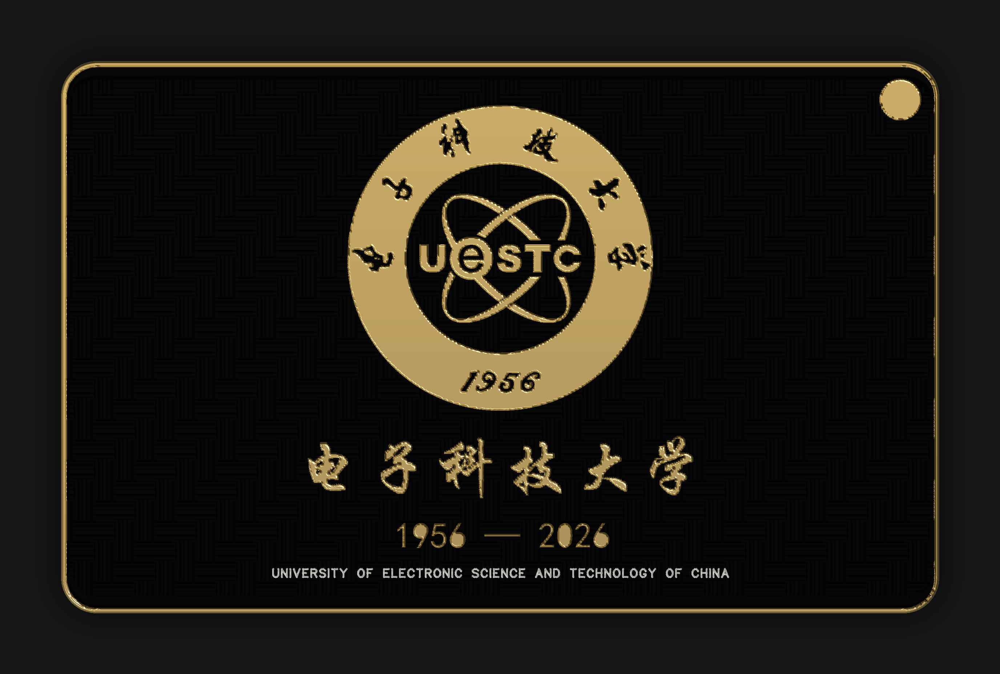

# UESTC70：电子科技大学 70 周年纪念板

86.25 × 54.25 mm，哑黑阻焊 + 沉金 + 白丝印，双面 2 mm 编织纹（回放参考板纹路表）。
交付时 `13-check --weave` 全绿，见 `验收单.md`。



## 文件

| 文件 | 说明 |
|---|---|
| `spec.json` | 全部设计参数（尺寸/金带/织纹/徽记/文字/孔），`16-build_board` 的唯一输入 |
| `badge.png` | 徽记源图（1024 px 官方线条图，圆盘型） |
| `gerber.zip` | 导出的 Gerber 包，`13-check` 的金板 |
| `验收单.md` | `13-check --md` 生成，数字不可手改 |
| `preview/` | 3D 正/背 + 徽记 60 px/mm |

## 复现（三步，最后一步必须人工）

**第 1 步：改 spec**（可选）

`spec.json` 里全是毫米，没有像素：`frame` 金带压在板框上、`weave.clip` 织纹裁剪半宽、
`badge` 徽记直径/圆心、`texts` 汉字、`strings` 拉丁字母、`holes` 钻孔。
换尺寸就改 `board`/`frame`/`weave.clip`，同时在 `templates/blank` 里改板框。

**第 2 步：生成 .epcb2**（离线，能自动化）

```bash
python scripts/16-build_board.py examples/uestc70/spec.json templates/blank out/PCB1.epcb2
```

应当打印 `37571 records`。把它拷进工程的 `pcb/PCB1.epcb2`，然后
**`session close --destroy` 再 `open`**——编辑器不会自动重载磁盘改动（04 第 109 条）。

**第 3 步：导出 + 自检**（必须人工，EDA 里点）

导出 Gerber → 跑 `13-check`：

```bash
python scripts/13-check.py out/gerber.zip --board 86.25x54.25 --weave --md out/验收单.md
```

全绿才打包；打包后用 `19-pack_order.py` 出 MANIFEST，解压前后各 `--verify` 一次。

## 这一版的关键数字

| 项 | 值 |
|---|---|
| 板尺寸 | 86.25 × 54.25（板框线宽外沿） |
| 沉金 | 1049.94 mm² = **22.46%**（正 18.42 / 背 11.73） |
| 最小铜 / 丝印 | 0.120 / 0.140 mm |
| 白丝印 / 哑黑 | 0.60% / 79.73% |
| 织纹 | 5749 条 / 2239 mm² / 与参考板表 **100%** 吻合 / 覆盖率 55.1% |
| 钻孔 | φ3.0 ×1 + φ0.305 ×8（参考板的挂绳孔组） |
