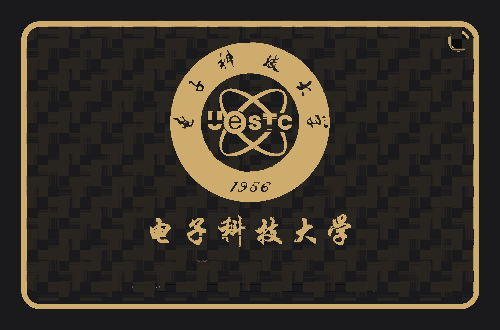
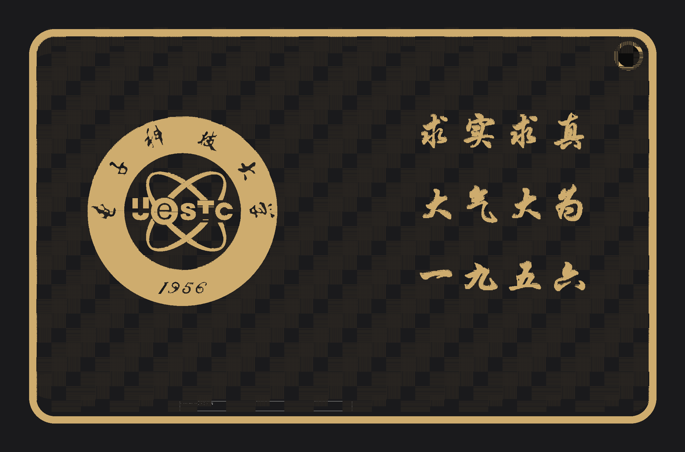

# 三个版式模板（P2 起手用）

同一块 86.2 × 54.2 的板，三种排法。**复制一份改数字**，不要从空白开始设计。

| 模板 | 长得像 | 适合 | 金占比（估） |
|---|---|---|---|
| `A-badge-centered.json` | 徽记居中 + 一行校名 + 日期 + 英文 | 纪念牌、校庆板、信息量中等 | ~22% |
| `B-left-right.json` | 左徽记、右侧三行短句 | 生日卡、"姓名 + 日期 + 一句话" | ~18% |
| `C-bleed.json` | 徽记 φ40 + 金带出血 2 mm | 想更"满"、更贵气 | ~26% |

预览（`20-preview_spec.py`，24 px/mm，不是最终效果）：

| A | B | C |
|---|---|---|
|  |  |  |

> 预览里**拉丁字母只画成一个等长细框**：文本对象（`STRING`）的真字形在 EDA 里生成，
> 离线只能按实测字宽 0.617 × fontSize 画个占位条。汉字是扫描线，所以看得见。

## 怎么用

```bash
cp templates/layouts/B-left-right.json skill测试/我的板/spec.json
# 改：badge.png（换成你的徽记）、texts[].s（你的字）、cx/cy、holes
python scripts/20-preview_spec.py skill测试/我的板/spec.json templates/blank out/mock.png --sc 24
```

看到位置对了再进 EDA；**不要跳过这一步直接落板**——版式在 mock 阶段改是分钟级，进 EDA 再改是小时级。

## 三个模板共同的硬约束（改的时候别破）

| 约束 | 值 | 破了会怎样 |
|---|---|---|
| 金带贴板框 | 中心线 = 板框线，`cu 1.0` 时可见 0.49 mm | 金线"缩在里面"，整块板看起来小一圈（04 第 112 条） |
| 织纹裁剪 | `clip = [板宽/2 − 0.55, 板高/2 − 0.55]`，`r` = 板框圆角 − 0.6 | 织纹顶到板边会出现锯齿缺口 |
| 徽记离板边 | ≥ 6 mm（挂绳孔那一侧 ≥ 8 mm） | 描摹边缘会被板框切掉 |
| 文字离板边 | ≥ 3 mm，行间 ≥ 1.5 mm | 丝印会被板框线压住 |
| 挂绳孔 | 距右/上边各 3.70 / 3.58，φ3.0 孔 + φ4.0 盘 + 8×φ0.305 | 抄参考板的数字，别自己定（`07` 第 2 条） |

## 换板尺寸时按这个顺序改

1. `board` / `frame` 的 `w` / `h` / `r`；
2. `weave.clip`（第 1 条公式）；
3. `templates/blank/pcb/PCB1.epcb2` 里那条 `layerId=11` 的板框 POLY；
4. 所有 `texts[].cy` / `badge.cy` —— 按新高度重排，别硬套旧数字；
5. 跑 `20-preview_spec.py` 看一眼，再落 EDA。
